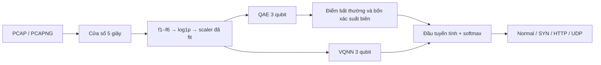

# QAE-QNN IDS

**Hybrid Quantum DDoS Detection System** phân tích capture offline bằng Quantum Autoencoder (QAE) và Hybrid Quantum Neural Network (QNN). Ứng dụng chạy trên Windows với PyTorch và Qiskit trên CPU.



QAE và VQNN đều mô phỏng statevector trên máy tính cổ điển. Dự đoán trong giao diện được tính từ PCAP đã lưu. Multiclass dùng argmax. Chỉ số Benign và Attack dùng `1 − P(Normal) ≥ 0,5` như cell đánh giá binary. Điểm QAE dùng ngưỡng riêng từ config.

## Cài đặt trên Windows

Từ thư mục dự án, dùng CPython x64 3.11.9 hoặc Python 3.11 tương thích với các wheel trong requirements.

```powershell
python -m venv .venv
$py = ".\.venv\Scripts\python.exe"
$env:PYTHONUTF8 = "1"
& $py -m pip install -r requirements.txt
& $py -m pip check
& $py -m scripts.check_environment
& $py -m scripts.verify_model
& $py -m scripts.verify_inference
& $py -m streamlit run app.py
```

Mở địa chỉ localhost do Streamlit in ra. `verify_inference` dùng feature và prediction xuất từ Colab để kiểm tra checkpoint. PCAP Analysis và Replay đọc nội dung capture mỗi khi người dùng chọn phân tích.

## Model và capture demo

Bundle hiện có trong `models/`. Nếu thiếu, chạy cell export cuối của notebook PCAP với bộ artifact đã train trên Drive, rồi giải nén `Train_PCAP_Export.zip` vào thư mục dự án, giữ nguyên `models/` và `results/pcap/`. Chỉ dùng `scaler.joblib` từ bundle tin cậy. Benchmark lấy từ `Benchmark_Results.zip` và đặt ba thư mục export dưới `results/benchmark/`.

Bốn file demo lấy từ `01_synthetic_data.zip`. Lệnh chuẩn bị kiểm tra MD5 của ZIP và SHA-256 từng capture trước khi ghi vào `data/pcap/`. [Nguồn dữ liệu Zenodo](https://zenodo.org/records/21705919)

```powershell
& $py -m scripts.prepare_demo data/01_synthetic_data.zip
& $py -m scripts.verify_capture
& $py -m scripts.analyze_pcap data/pcap/NORMAL_30s_20260729_121618.pcap --csv normal-results.csv
& $py -m unittest discover -s tests -v
```

CLI đọc tuần tự từ đĩa qua hai lượt và giữ các bộ đếm theo cửa sổ. Streamlit giữ upload trong bộ nhớ và giới hạn 200 MB mỗi file theo mặc định, vì vậy CLI phù hợp với capture lớn. Đầu ra CSV dùng đường dẫn mới để bảo vệ dữ liệu có sẵn.

Thêm `--all-test` vào cả `scripts.prepare_demo` và `scripts.verify_capture` để kiểm tra 16 capture test. Tùy chọn này cần khoảng 352 MB cho các PCAP đã giải nén ngoài 161 MB của ZIP.

## Các trang

| Trang | Chức năng |
| --- | --- |
| Dashboard | Trạng thái checkpoint, chỉ số phiên gần nhất, timeline, phân bố và sự kiện |
| PCAP Analysis | Upload hoặc mở demo, xem f1–f6, lọc nhãn, xem chi tiết và tải CSV |
| PCAP Replay | Đọc file offline, phát dự đoán theo mốc tương đối và điều khiển tốc độ |
| Benchmark Research | Số liệu thực theo dataset, fold, model và phiên bản, so sánh V2/V4 ghép cặp |
| Model Evaluation | Confusion matrix, ROC/PR trên các tập có điểm xuất, FP/FN và ablation |
| About | Mô hình, định nghĩa feature, môi trường và giới hạn |

## Cấu trúc

- `app.py`, `pages/`, `.streamlit/` chứa giao diện và cấu hình.
- `core/` đọc PCAP, trích feature, phục hồi mô hình, chạy inference và đọc dữ liệu đánh giá.
- `models/` chứa checkpoint, scaler và metadata. `results/` lưu kết quả Colab. `notebooks/` giữ tài liệu nghiên cứu gốc.
- `scripts/` chứa lệnh kiểm tra, chuẩn bị demo và phân tích. `tests/` chứa bộ kiểm thử tự động.
- `data/` chứa dữ liệu nội bộ đã được bỏ qua trong Git. Các artifact model hiện dưới 3 KB mỗi file. Với bundle lớn hơn, có thể lưu bản phát hành nội bộ hoặc dùng Git LFS và ghi checksum trong tài liệu.

## Kết quả và giới hạn

Export PCAP ghi QAE+QNN đạt accuracy, macro-F1, binary F1 và binary ROC-AUC bằng 1,0 trên tập test nghiên cứu. QNN, RF và MLP cùng đạt các giá trị này trong bảng đó. Benchmark cuối của CIC-DDoS2019 ghi macro-F1 trung bình 0,86517 cho QAE+QNN V4 trên hai fold. Xem bảng nguồn để đối chiếu số liệu. [PCAP metrics](results/pcap/metrics.csv) · [Benchmark classification summary](results/benchmark/final/classification_summary.csv)

PCAP tổng hợp dùng nhãn ở cấp capture và có feature trùng giữa các split. Benchmark V2/V4 gồm hai fold với seed 42, khác ngân sách tuning và lượng dữ liệu train classifier. Điểm softmax không được kiểm chứng hiệu chuẩn trên lưu lượng mạng thực. Cửa sổ thiếu dữ liệu và capture dưới 5 giây có thể không tạo được dự đoán.

Xem [hướng dẫn trình diễn](docs/DEMO_GUIDE.md), [kiểm tra workspace](docs/PROJECT_AUDIT.md) và [nhật ký kiểm thử](docs/IMPLEMENTATION_PROGRESS.md). Tài liệu phần mềm [Qiskit Quantum Information](https://qiskit.qotlabs.org/docs/api/qiskit/quantum_info) · [PyTorch CPU](https://pytorch.org/get-started/previous-versions/) · [Streamlit fragments](https://docs.streamlit.io/develop/api-reference/execution-flow/st.fragment)
