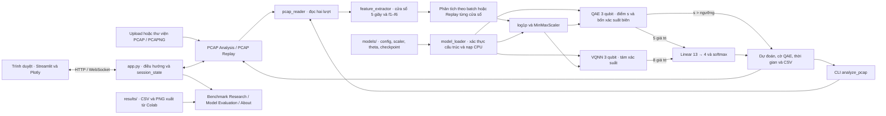

# Phân tích kỹ thuật hệ thống phát hiện DDoS QAE–QNN

**Đồ án môn Mã hóa mật mã · Kiểm tra workspace ngày 25/11/2026**

## 1. Tổng quan hệ thống

QAE–QNN IDS là nguyên mẫu phát hiện DDoS theo cửa sổ thời gian từ tệp ghi lưu lượng. Hệ thống nhận PCAP hoặc PCAPNG, trích sáu đặc trưng, dùng Quantum Autoencoder (QAE) để chấm điểm bất thường và tạo đặc trưng bổ sung, rồi dùng Variational Quantum Neural Network (VQNN) có đầu tuyến tính cổ điển để phân loại. Hai mạch 3 qubit được mô phỏng statevector trên CPU. Phần lượng tử phục vụ phát hiện xâm nhập, khác với bài toán mã hóa hoặc giải mã lưu lượng. [README.md](README.md) · [core/inference.py](core/inference.py)

| Hạng mục | Phạm vi thực tế |
|---|---|
| Đầu vào vận hành | Tệp upload qua Streamlit, tệp cục bộ trong thư viện demo hoặc đường dẫn cho CLI. Đơn vị suy luận là một cửa sổ đầy đủ có gói. |
| Đầu ra vận hành | `Normal`, `SYN`, `HTTP`, `UDP`, quyết định `Benign`/`Attack`, xác suất tấn công, độ tin cậy softmax, điểm và cờ QAE, thông tin cửa sổ, thời gian xử lý, biểu đồ và CSV. |
| Đầu vào nghiên cứu | Bảng kết quả Colab cho PCAP tổng hợp và ba benchmark đã xử lý. Nhãn benchmark là nhị phân. |
| Công nghệ | Python, Streamlit và Plotly cho ứng dụng. Scapy và dpkt cho capture. NumPy, pandas, scikit-learn và joblib cho dữ liệu. Qiskit và PyTorch CPU cho mô phỏng và suy luận. Notebook dùng thêm SciPy để tối ưu QAE. |
| Ranh giới | Ứng dụng IDS ngoại tuyến. Chức năng thu gói trực tiếp, chặn lưu lượng và gửi cảnh báo ra ngoài chưa được triển khai. |

| Đường dẫn | Vai trò |
|---|---|
| `app.py`, `pages/`, `.streamlit/` | Điểm vào, điều hướng, giao diện, biểu đồ, CSS và thiết lập server. |
| `core/` | Hợp đồng mô hình, đọc capture, trích đặc trưng, chuẩn hóa, suy luận, Replay và đánh giá. |
| `models/` | Checkpoint, scaler, tham số QAE, metadata và checksum. |
| `notebooks/` | `Train_PCAP_Final (1).ipynb` cho PCAP V3 và `Train_Benchmark_Final (1).ipynb` cho nghiên cứu V2/V4. |
| `results/pcap/`, `results/benchmark/` | CSV và hình xuất từ Colab. Benchmark gồm `baseline/`, `improved/` và `final/`. |
| `scripts/`, `tests/` | CLI phân tích, chuẩn bị demo, xác minh bundle/môi trường và kiểm thử tự động. |
| `data/`, `assets/`, `docs/` | Dữ liệu và ảnh kiểm tra giao diện cục bộ, vị trí tài nguyên, hướng dẫn và hồ sơ kiểm chứng. `data/` được Git bỏ qua. |
| `requirements.txt`, `README.md`, `NOTICE.md` | Phiên bản phụ thuộc, cách chạy, nguồn gốc dữ liệu và lưu ý về giấy phép. |

## 2. Kiến trúc và giao tiếp

Frontend là trình duyệt hiển thị widget, bảng và biểu đồ Plotly do Streamlit tạo. Backend là cùng tiến trình Python phục vụ Streamlit. `app.py::main` dùng radio ở sidebar để gọi hàm dựng trang. Widget kích hoạt lần chạy lại của Streamlit, còn Replay dùng `st.fragment` để cập nhật vùng điều khiển định kỳ. Giao tiếp trình duyệt–server đi qua cơ chế HTTP/WebSocket của Streamlit. Trong server, các mô-đun trao đổi trực tiếp qua hàm Python, `DataFrame`, mảng NumPy và tensor PyTorch. Dự án cung cấp API Python nội bộ và CLI, chưa định nghĩa REST API công khai. [app.py](app.py) · [pages/traffic.py](pages/traffic.py) · [pages/charts.py](pages/charts.py)



Các điểm vào chính là `extract_pcap(source, window, progress)`, `analyze_pcap(source, engine, progress)`, `load_model(directory)`, `InferenceEngine.predict(rows, batch_size=512, include_probabilities=False)` và `Replay.start/pause/resume/stop/advance/results`. `core/evaluation.py::exported_demo_predictions` ghép prediction với nhãn test theo tên capture, còn `evaluate_predictions` tính confusion, ROC, PR và các dòng lỗi. `model_loader.py::_load_cached` cache tối đa bốn bundle theo thư mục tuyệt đối, `mtime_ns` và kích thước của bốn artifact. [core/](core/)

## 3. Xử lý lưu lượng và chuẩn hóa

**Đọc capture.** `pcap_reader.py::open_capture` mở đường dẫn dạng nhị phân hoặc dùng trực tiếp stream có thể `seek`. `packets` dùng Scapy `RawPcapReader` nhận dạng theo header, xử lý PCAP microsecond/nanosecond và timestamp theo độ phân giải từng record của PCAPNG. Timestamp được tính bằng `Decimal` rồi chuyển sang `float`. `_CaptureStream.read` giới hạn số byte đọc theo kích thước tệp và phát hiện record hoặc block bị cắt. `decode` dùng bảng link type của Scapy, có đường lùi sang dữ liệu thô theo cấu hình Scapy. `feature_extractor.py::fast_fields` dùng dpkt cho Ethernet/IPv4 TCP hoặc UDP có cấu trúc thông thường trong PCAP cổ điển. Trường hợp khác chuyển sang Scapy. PCAPNG đi qua Scapy kể cả khi có đuôi `.pcap`. [core/pcap_reader.py](core/pcap_reader.py) · [core/feature_extractor.py](core/feature_extractor.py)

**Chia cửa sổ.** `extract_pcap` đọc lượt một để đếm toàn bộ gói và lấy $t_0=\min(t)$, $t_1=\max(t)$, kể cả khi record lệch thứ tự. Với $W=5$ giây, đặt $K=\lfloor(t_1-t_0)/W\rfloor$. Lượt hai gán mỗi gói vào $i=\lfloor(t-t_0)/W\rfloor$. Giữ $i<K$ và chỉ xuất bucket có gói, sắp theo `window_id`. Cửa sổ $i$ là $[iW,(i+1)W)$ tính theo thời gian tương đối. Gói đúng biên chuyển sang cửa sổ kế tiếp và bị bỏ nếu rơi vào bucket cuối ngoài phạm vi giữ. Capture ngắn hơn 5 giây hoặc chỉ có bucket trống trong phạm vi đầy đủ sẽ không có dự đoán. `capture.packets` đếm cả gói trong phần đuôi bị bỏ, còn `sum(packet_count)` chỉ đếm gói được đưa vào các cửa sổ. [core/feature_extractor.py](core/feature_extractor.py) · [core/pcap_analysis.py](core/pcap_analysis.py)

**Định nghĩa đặc trưng.** Gọi $N$ là tổng số gói trong cửa sổ, $S$ là tập IPv4 nguồn được giải mã, $n_s$ là số gói có IPv4 nguồn $s$, và $h_s$ là số gói TCP của $s$ chứa chuỗi byte `GET` hoặc `POST` trong payload. Các bộ đếm được cập nhật ở `Window.add` và kết xuất ở `Window.row`. [core/feature_extractor.py](core/feature_extractor.py)

| Đặc trưng | Công thức | Ý nghĩa và quy tắc đếm |
|---|---|---|
| `f1` | $N$ | Tổng số gói, trùng `packet_count`. Đếm cả gói không có IPv4 nguồn. |
| `f2` | $N_{\mathrm{flags}=2}/\max(N_{\mathrm{flags}=18},1)$ | Tỷ số TCP SYN/SYN+ACK. Chỉ đếm khi toàn bộ giá trị flags bằng 2 hoặc 18. |
| `f3` | Số phần tử của $S$ | Số địa chỉ IPv4 nguồn phân biệt. |
| `f4` | $\max_{s\in S} h_s$, mặc định 0 | Số gói chứa dấu hiệu GET/POST lớn nhất của một IPv4 nguồn. So khớp byte phân biệt hoa thường trên từng gói. |
| `f5` | $-\sum_{s\in S}(n_s/N)\log_2(n_s/N)$ | Entropy nguồn theo định nghĩa của dự án. Khi có gói thiếu IPv4 nguồn, tổng các khối xác suất có thể nhỏ hơn 1 vì mẫu số vẫn là $N$. |
| `f6` | $N_{\mathrm{UDP}}$ | Số gói được giải mã có lớp UDP. |

`f4` là dấu hiệu ở payload, nên có thể nhận nhầm chuỗi tình cờ hoặc bỏ sót request bị chia segment và HTTPS. Các phép đếm đang tổng hợp toàn capture theo thời gian, thiếu chiều đích, dịch vụ và phiên TCP. Phần đặc trưng theo IP chỉ xét nguồn IPv4. [core/feature_extractor.py](core/feature_extractor.py)

**Chuẩn hóa.** `preprocessing.py::transform` chọn đúng sáu cột theo tên và thứ tự config, kiểm tra số thực hữu hạn và miền `f > -1`, sau đó tính $g_j=\ln(1+f_j)$. Kết quả đưa vào scaler đã fit và tính $x_j=\operatorname{clip}(g_j\cdot\texttt{scale\_}_j+\texttt{min\_}_j,0,1)$. Với cột train không hằng, phép biến đổi trước clip tương đương $(g_j-\min_{train,j})/(\max_{train,j}-\min_{train,j})$. Việc dùng hệ số lưu sẵn áp dụng đúng cả quy tắc xử lý cột hằng của scikit-learn. QAE dùng giá trị chuẩn hóa `float64`. Ghép sáu giá trị này với năm giá trị QAE thành tensor `N×11 float32` cho VQNN. Nhãn, tên tệp và metadata thời gian chỉ phục vụ hiển thị hoặc đánh giá. [core/preprocessing.py](core/preprocessing.py) · [core/inference.py](core/inference.py) · [tests/test_review_contracts.py](tests/test_review_contracts.py)

**Replay và Live Capture.** `replay_page` trích toàn bộ cửa sổ một lần khi nhấn Start. `Replay.advance` cộng thời gian monotonic đã trôi nhân hệ số tốc độ, suy luận từng cửa sổ khi `window_end_s ≤ position_s` và giới hạn 24 cửa sổ mỗi lượt cập nhật. Fragment được lên lịch khoảng 0,4 giây khi đang chạy. Pause giữ tiến độ, Resume đặt lại mốc đồng hồ, Stop giữ các kết quả đã có, Start lại xóa kết quả Replay của lần chạy cũ trong đối tượng. Tốc độ UI từ 0,25× đến 16×. Replay chỉ phát lại kết quả phân tích theo mốc capture, không gửi lại gói lên mạng. Live Capture chưa có nguồn interface, bộ lọc thu gói, vòng đệm hoặc logic đóng cửa sổ theo đồng hồ thực. [core/pcap_replay.py](core/pcap_replay.py) · [pages/traffic.py](pages/traffic.py)

## 4. Mô hình QAE–QNN triển khai

### 4.1. QAE và điểm bất thường

`qae.py::amplitudes` thêm hai số 0 vào sáu giá trị chuẩn hóa. Nếu vector khác 0, chia cho chuẩn $L_2$ để tạo statevector tám biên độ. Vector toàn 0 được ánh xạ về $\lvert000\rangle$. `encoder` tạo mạch 3 qubit, mỗi lớp áp dụng lần lượt $R_X,R_Y,R_Z$ trên từng qubit rồi vòng $\mathrm{CX}(0,1),\mathrm{CX}(1,2),\mathrm{CX}(2,0)$. Cấu hình hiện tại có **một lớp**, tức chín góc học được và ba CX trong encoder. `QAE.__init__` tạo toán tử $U$ kích thước $8\times8$. [core/qae.py](core/qae.py) · [models/config.json](models/config.json)

Với statevector mã hóa $z$, đặt $p_i=\lvert(Uz)_i\rvert^2$. Theo quy ước Qiskit, $q_2$ là bit cao nhất của ba qubit. Đây là qubit *trash*, còn $q_0,q_1$ tạo phần latent. `QAE.features` trả $[s,p_0+p_4,p_1+p_5,p_2+p_6,p_3+p_7]$, trong đó $s=\sum_{i=4}^{7}p_i=P(q_2=1)$ và fidelity với trạng thái đích của trash là $F=P(q_2=0)=1-s$. Bốn giá trị còn lại là phân phối xác suất biên của hai qubit latent sau khi cộng theo trash. [core/qae.py](core/qae.py) · [Quy ước thứ tự bit của Qiskit](https://quantum.cloud.ibm.com/docs/en/guides/bit-ordering)

Trong notebook PCAP, `qae_fit` tối thiểu hóa $1-\operatorname{Tr}[(U\rho U^\dagger)_{0:4,0:4}]$ trên trạng thái mật độ trung bình của các cửa sổ Normal thuộc train, bằng L-BFGS-B. Ngưỡng lấy phân vị 90% của điểm trên các cửa sổ Normal thuộc validation. Bundle ghi `threshold = 0.0011343907644426237`, loss `0.0003992866501055792`, 12 vòng tối ưu và trạng thái hội tụ. Runtime báo `qae_alert` khi **$s>\tau$**, nên bằng ngưỡng thì cờ là False. Notebook có đoạn kiểm tra SWAP test lý tưởng trên năm qubit với $s=2(1-P(\mathrm{ancilla}=0))$. Runtime dùng xác suất trực tiếp từ toán tử ba qubit. Điểm là xác suất trash lệch trạng thái đích, hệ thống triển khai encoder và phần đọc xác suất mà không dựng decoder tái tạo vector. [Notebook PCAP, ô 14–15](<notebooks/Train_PCAP_Final (1).ipynb>) · [core/inference.py](core/inference.py)

### 4.2. VQNN, ghép đặc trưng và quyết định

1. `hybrid_model.py::VQNN.forward` tạo trạng thái $\lvert000\rangle$ trên **3 qubit**. Hai khối mã hóa góc dùng $R_Y(\pi x_j)$ lần lượt cho `f1–f3` rồi `f4–f6`, mỗi khối theo sau bởi vòng ba CX.
2. Hai lớp biến phân áp dụng ba $R_Y(\theta)$ rồi vòng CX giống trên. Mạch VQNN có sáu góc dữ liệu, sáu góc học và 12 CX. `ry` trộn biên độ theo bit qubit và `cx` hoán vị chỉ số. Bình phương tám biên độ thực cho tám xác suất theo cơ sở tính toán.
3. Năm giá trị QAE được nối **sau** phần mô phỏng mạch. Tám xác suất VQNN và năm giá trị QAE tạo đầu vào 13 chiều cho `Linear(13, 4)`. Đầu ra là bốn logits, sau đó `predict` dùng softmax theo thứ tự `Normal`, `SYN`, `HTTP`, `UDP`. Hai mạch là hai nhánh mô phỏng riêng, ghép bằng dữ liệu cổ điển.
4. Nhãn đa lớp là `argmax`, `confidence = max(softmax)`. Điểm nhị phân là `attack_probability = 1 − P(Normal)` và quyết định `Attack` khi điểm **≥ 0,5**. Hai phép quyết định có thể khác nhau, chẳng hạn `Normal` vẫn đứng đầu từng lớp nhưng tổng xác suất ba lớp tấn công đạt 0,5. Cờ QAE độc lập với quyết định nhị phân. Mọi cửa sổ hợp lệ được đưa qua VQNN, và điểm QAE liên tục tham gia đầu tuyến tính dù cờ là True hay False. [core/hybrid_model.py](core/hybrid_model.py) · [core/inference.py](core/inference.py)

| Tệp | Vai trò và thông số xác minh được |
|---|---|
| `models/hybrid.pt` | PyTorch state dict CPU `float32`. `theta (2,3)`, `head.weight (4,13)`, `head.bias (4,)`, tổng 62 tham số. |
| `models/qae_theta.npy` | Chín góc `float64` của encoder, dùng để dựng toán tử `complex128 (8,8)`. |
| `models/scaler.joblib` | MinMaxScaler đã fit trên 259 cửa sổ train sau `log1p`, sáu chiều, `clip=True`, miền `[0,1]`, hệ số `float64`. |
| `models/config.json` | Cửa sổ 5 s, một lớp QAE, thứ tự đặc trưng/lớp, ngưỡng QAE, ID extractor, seed 42, 60 epoch và thông tin tối ưu. Ngưỡng nhị phân 0,5 nằm trong `core/config.py`. |
| `models/environment.json` | Tám phiên bản thư viện của môi trường Colab, dùng làm chuẩn cho `scripts.check_environment`. |
| `models/checksums.sha256` | SHA-256 của bốn tệp mô hình/cấu hình, được dùng bởi `scripts.verify_model` và unit test đối chiếu. |

## 5. Nhất quán giữa huấn luyện và triển khai

Số ô notebook dưới đây đếm từ 1 theo thứ tự file `.ipynb`, gồm cả ô Markdown. Notebook PCAP mặc định `RETRAIN=False` và tái sử dụng artifact V3. Mã nhánh huấn luyện vẫn có trong notebook để đối chiếu. [Train_PCAP_Final (1).ipynb](<notebooks/Train_PCAP_Final (1).ipynb>)

| Thành phần | Huấn luyện và triển khai | Kết luận |
|---|---|---|
| Đặc trưng/cửa sổ | Ô 9–12, `extract_pcap`, `extract_reference`, `finish` ↔ `core/feature_extractor.py`. Cùng min/max timestamp, 5 s, bucket không rỗng và thứ tự `f1–f6`. | Notebook có đường nhanh gom record trước khi tạo bucket, runtime đọc hai lượt và bổ sung xử lý lỗi/PCAPNG. Bộ capture test xác nhận tương đương cho dữ liệu đã kiểm. |
| Scaler | Ô 12/24 fit `MinMaxScaler(clip=True)` trên `log1p` của train, dùng lại khi suy luận ↔ `transform`, `_load_cached`. | Khớp thứ tự và miền. Notebook fit từ NumPy nên tên cột có thể không lưu trong scaler. Runtime kiểm tên khi thuộc tính tồn tại và luôn lấy cột theo config. |
| QAE | Ô 14–15/22 định nghĩa amplitude encoding, mạch, điểm, phân vị và lưu tham số ↔ `QAE.features`, `ModelConfig.read`, `predict`. | Cùng chín góc/cấu hình một lớp, năm đầu ra và phép so sánh ngưỡng nghiêm ngặt. |
| VQNN và học hai giai đoạn | Ô 17–18 tạo `VQNN(4,5)` và đóng băng đầu ra QAE đã tính trước. Adam `lr=0.01`, `weight_decay=1e-4`, batch 64, 60 epoch, weighted cross-entropy với $w_c=N/(C n_c)$. Ô 22/24 lưu và nạp state dict. | Runtime dựng cùng forward, nạp `strict=True`, chạy `eval()` và tắt gradient. Khởi tạo mặc định khác nhau nhưng tham số được khôi phục đầy đủ trước suy luận. |
| Nhãn và hai ngưỡng | Ô 7/12/20/24 dùng nhãn cấp capture, thứ tự `Normal=0`, `SYN=1`, `HTTP=2`, `UDP=3`. Runtime `config.py`/`predict` dùng cùng thứ tự, ngưỡng binary `≥0.5`, QAE `>τ`. | Runtime tính nhãn từ feature. Tên capture, nhãn manifest và các cột không liên quan không tham gia suy luận. |

Split phân tầng theo capture, theo tỷ lệ 60/20/20 với seed 42. Từ 80 capture và 429 cửa sổ, train có 48 capture / 259 cửa sổ, validation 16 / 87 và test 16 / 83. Theo thứ tự `Normal, SYN, HTTP, UDP`, số cửa sổ là train `(121,48,45,45)`, validation `(45,12,12,18)`, test `(40,18,15,10)`. Bảng leakage ghi 0 tệp và 0 SHA-256 trùng giữa các cặp split, nhưng có 17/18/11 vector feature trùng tương ứng train–validation/train–test/validation–test. Điều này làm giảm giá trị suy rộng của kết quả trên dữ liệu tổng hợp. [results/pcap/split.csv](results/pcap/split.csv) · [Phân bố dữ liệu](results/pcap/evaluation_extra/data_distribution.csv) · [Kiểm tra trùng lặp](results/pcap/evaluation_extra/leakage_check.csv)

**Benchmark là quy trình nghiên cứu riêng.** `Train_Benchmark_Final` dùng CSV sáu feature đã xử lý và nhãn `0/1`, mặc định MinMax trực tiếp, với scaler riêng cho QAE và classifier. `audit_clean` loại dòng thiếu/vô hạn và trùng cả dòng, giữ xung đột nhãn để báo cáo. `split_data` nhóm theo hash vector feature trong `StratifiedGroupKFold`, tách 50 mẫu Normal fit và 50 mẫu Normal hiệu chỉnh ngưỡng QAE. V4 giữ hai outer fold, dùng inner validation để chọn depth QAE 1–3, anchor 0 hoặc 1, depth QNN 2–4, learning rate, nguồn đặc trưng QAE và cách fusion. `tune_one` lưu checkpoint theo macro-F1 validation và dùng loss để phân xử; dừng sau 15 epoch không cải thiện, tối đa 100 epoch. `run_v4` giữ checkpoint đã chọn mà không refit toàn classifier pool. Model benchmark có hai lớp đầu ra, nên không thay thế checkpoint PCAP V3 bốn lớp. [Notebook benchmark, ô 8–18 và 29–47](<notebooks/Train_Benchmark_Final (1).ipynb>)

## 6. Chức năng ứng dụng và trạng thái

| Trang hoặc chức năng | Nội dung và căn cứ | Mức kiểm chứng |
|---|---|---|
| Dashboard | `traffic.py::dashboard` hiển thị model, ngưỡng khi chưa có phiên, sau đó hiển thị tên phiên gần nhất, số gói, số cửa sổ, Benign/Attack, tỷ lệ tấn công, thời gian, timeline, gauge tỷ lệ Attack, donut nhị phân, phân bố lớp và 10 sự kiện mới nhất. | Đã triển khai. AppTest kiểm tra trạng thái ban đầu và số cửa sổ sau phân tích demo Normal. |
| PCAP Analysis | `capture_source` nhận upload hoặc quét `data/pcap`, `data/demo`, `data/test_pcap`. `analysis_page` hiển thị progress, mốc bắt đầu theo Asia/Bangkok, thời lượng, thời gian trích xuất và inference, bộ lọc verdict/lớp, timeline, đồ thị từng `f1–f6`, bảng và chi tiết theo `window_id`. Nút `Export full CSV` tải toàn bộ kết quả, kể cả khi đang lọc. | Đã triển khai. AppTest thao tác với thư viện demo và tìm thấy nút tải. Pipeline và CLI kiểm tra nội dung CSV. Upload qua trình duyệt và tải xuống thực tế chưa được chạy lại trong lần rà soát. |
| PCAP Replay | `replay_page` có chọn tệp, chọn tốc độ, Start/Pause/Resume/Stop, thanh tiến độ kèm mốc capture, timeline và tối đa 25 sự kiện gần nhất. | Đã triển khai. AppTest với UDP kiểm tra nút. Unit test kiểm tra mốc theo đồng hồ giả lập, tốc độ và kết quả Replay khớp Analysis trên fixture. |
| Benchmark Research | `research.py::benchmark_page` đọc `all_metrics.csv` theo nhóm kết quả tổng hợp/V2/V4, lọc dataset/task/metric, vẽ trung bình và độ lệch chuẩn, hiện số fold và bảng ghép cặp V2/V4 từ `final/paired_comparison.csv`. Có bảng PCAP metrics. | Đã triển khai. AppTest kiểm tra mở trang với artifact hiện có. Chưa duyệt hết các tổ hợp bộ lọc trong lần rà soát. |
| Model Evaluation | `evaluation_page`, `_performance`, `_ablation` hiện confusion gốc, confusion đa lớp tính từ các dòng có prediction, ROC/PR, FP/FN và ablation về anchor, depth QAE, fusion và early stopping. Tập bốn demo dùng điểm Hybrid `attack_probability` và ngưỡng 0,5, tập Novel dùng `anomaly_score` và ngưỡng QAE cho ROC/PR và FP/FN. Confusion đa lớp của cả hai tập dùng nhãn Hybrid. | Đã triển khai. AppTest kiểm tra mở trang. Lần rà soát đọc và đối chiếu CSV, chưa thao tác toàn bộ tab trên trình duyệt. |
| About | `research.py::about_page` mô tả pipeline, sáu đặc trưng, phiên bản Colab, giới hạn và tài liệu tham khảo. | Đã triển khai, AppTest kiểm tra mở trang. |
| Live Capture, REST API công khai, cảnh báo ngoài ứng dụng, lưu lịch sử bền vững, chặn lưu lượng | Chưa có luồng tương ứng trong `app.py`, `pages/`, `core/` và `scripts/`. | Chưa triển khai. |

**Sự kiện và lưu trữ.** `pages/charts.py::events` trình bày thời gian tương đối, số gói, verdict, lớp, xác suất tấn công và cờ QAE cho từng cửa sổ. Đây là sự kiện phát hiện trong UI. `st.session_state` giữ `analysis_display`, `latest_traffic`, Replay và tiến độ. Dashboard chỉ dùng bộ kết quả gần nhất, có thể là Replay đang chạy. Khi Replay mới chưa có cửa sổ, Dashboard vẫn có thể hiện phiên trước. Trong Replay, chỉ số tổng gói của Dashboard là số gói toàn capture, trong khi số cửa sổ cập nhật theo tiến độ và thời gian có thể bao gồm khoảng Pause. UI chưa ghi nhật ký kiểm toán hoặc kết quả xuống cơ sở dữ liệu. `Analysis.csv_bytes` tạo CSV trong bộ nhớ. CLI `scripts.analyze_pcap::main` in tổng hợp và có thể ghi bằng chế độ `x` để tạo CSV mới. CSV Analysis/CLI mặc định gồm metadata cửa sổ, `f1–f6`, `anomaly_score`, `qae_alert`, `prediction`, `confidence`, `attack_probability`, `binary_prediction`, `inference_ms`. Bốn cột `prob_*` chỉ có khi gọi API Python với `include_probabilities=True`. [pages/traffic.py](pages/traffic.py) · [pages/charts.py](pages/charts.py) · [core/pcap_analysis.py](core/pcap_analysis.py) · [scripts/analyze_pcap.py](scripts/analyze_pcap.py)

## 7. An toàn thông tin

| Tài sản / mối đe dọa | Biện pháp hiện có | Đề xuất nếu mở rộng triển khai |
|---|---|---|
| PCAP, IP và payload / truy cập trái phép, lộ dữ liệu khi chia sẻ | `.streamlit/config.toml` cấu hình `localhost`, tắt thống kê sử dụng. `.gitignore` bỏ qua dữ liệu, PCAP, ZIP, file secrets và khóa theo các mẫu cấu hình. Kết quả CSV chỉ có đặc trưng tổng hợp và metadata cửa sổ. | Phân quyền tệp và phiên, ẩn thông tin định danh khi chia sẻ, kiểm soát thời hạn lưu giữ. Nếu triển khai qua mạng, thêm xác thực và TLS. |
| Mô hình, scaler, ngưỡng / artifact bị thay thế hoặc giải tuần tự nguồn lạ | `verify_model` kiểm SHA-256 trước khi phục hồi theo manifest checksum đang có. `model_loader` ép CPU, `torch.load(weights_only=True)`, `np.load(allow_pickle=False)`, kiểm config, scaler, shape/dtype/hữu hạn và nạp strict. `joblib.load` chạy trước kiểm kiểu scaler. | Chỉ dùng bundle tin cậy. Xác minh checksum từ kênh tin cậy hoặc chữ ký trước khi nạp trong mọi điểm vào. Giới hạn quyền ghi `models/` và cân nhắc định dạng scaler dữ liệu thuần. Checksum nằm cùng bundle chỉ chứng minh tính khớp với manifest đi kèm. |
| Capture/ZIP / tệp hỏng hoặc tiêu thụ CPU, RAM, đĩa | `_CaptureStream` ràng buộc theo byte và báo lỗi record hỏng. App giới hạn theo mặc định upload Streamlit 200 MB theo README. `prepare_demo` chỉ lấy mục trong manifest, kiểm đường dẫn, MD5 ZIP và SHA-256 từng capture. CLI đọc tuần tự, CSV không ghi đè. | Thêm quota gói, thời lượng, bucket và số job đồng thời, timeout, cô lập parser và kiểm thử tệp biên. Giới hạn upload theo byte cần đi cùng giới hạn khối lượng xử lý. |
| Kết quả/cảnh báo / sai lệch mô hình hoặc quyết định sai | QAE và Hybrid có cờ riêng, lịch sử sự kiện theo cửa sổ và các bảng ROC/PR/FP/FN. `transform` loại input sai định dạng và không hữu hạn. | Đánh giá trên dữ liệu được cấp phép, phân tách theo mạng/thời gian, hiệu chỉnh xác suất, giám sát drift, đối chiếu bằng nguồn IDS bổ sung trước khi dùng cảnh báo cho quyết định tự động. |

`load_model` trên UI và CLI phân tích dùng cache theo thời gian sửa/kích thước và kiểm hợp đồng, không tự gọi kiểm checksum. Chỉ báo sidebar `CPU inference ready` là nội dung tĩnh. Khi cần chứng minh model đã tải, dựa vào `MODEL READY` hoặc lỗi thực tế trong thân trang. Các helper HTML của `pages/ui.py` escape chuỗi trước khi chèn vào markup. Dự án chưa có cấu hình xác thực, TLS, nhật ký kiểm toán hay chính sách lưu giữ. [core/model_loader.py](core/model_loader.py) · [scripts/verify_model.py](scripts/verify_model.py) · [scripts/prepare_demo.py](scripts/prepare_demo.py) · [app.py](app.py) · [pages/ui.py](pages/ui.py) · [.streamlit/config.toml](.streamlit/config.toml)

## 8. Chạy chương trình, demo và kiểm thử

### 8.1. Chạy từ thư mục gốc trên Windows

README yêu cầu CPython x64 3.11. Nếu dùng workspace hiện tại đã có `.venv`, bắt đầu ở dòng `$py` và bỏ qua cài đặt khi thư viện đã được xác minh. `PYTHONUTF8` giúp console in đúng tiếng Việt. Mở `http://localhost:8501` sau khi server khởi động. Các lệnh dưới đây dùng bundle đã có. [README.md](README.md) · [requirements.txt](requirements.txt)

```powershell
python -m venv .venv
$py = '.\.venv\Scripts\python.exe'
$env:PYTHONUTF8 = '1'
& $py -m pip install -r requirements.txt
& $py -B -m scripts.check_environment
& $py -B -m scripts.verify_model
& $py -B -m streamlit run app.py --server.port 8501
```

Nếu thư viện demo trống và đã có ZIP đúng nguồn, chạy `& $py -B -m scripts.prepare_demo data/01_synthetic_data.zip`. Dùng `--all-test` khi cần chuẩn bị 16 capture. Để chạy CLI chỉ in kết quả, dùng `& $py -B -m scripts.analyze_pcap data/pcap/NORMAL_30s_20260729_121618.pcap`. Thêm `--csv <đường-dẫn-mới>` chỉ khi cần tạo bản xuất. [Hướng dẫn demo](docs/DEMO_GUIDE.md) · [Nguồn dữ liệu ghi trong dự án](NOTICE.md)

### 8.2. Kịch bản demo bằng tệp đã ghi

Trên **PCAP Analysis**, chọn **Demo library**, chọn tệp trong bảng, nhấn **Analyze Traffic**, rồi đọc số cửa sổ và lớp. Đối chiếu `qae_alert` và verdict ở **Inspect one window**. Có thể mở cùng tệp qua **Upload**. Kết quả tham chiếu dưới đây lấy từ bốn CSV xuất Colab và số gói tổng từ script đối chiếu capture. [results/pcap/predictions/](results/pcap/predictions/) · [scripts/verify_capture.py](scripts/verify_capture.py)

| Kịch bản | Tệp trong `data/pcap/` | Gói tổng / gói trong cửa sổ giữ | Cửa sổ và kết quả tham chiếu | Cờ QAE True |
|---|---|---:|---|---:|
| Normal | `NORMAL_30s_20260729_121618.pcap` | 1.276 / 1.062 | 5 Normal, 5 Benign | 1 |
| SYN | `SYN_HIGH_30s_20260729_111742.pcap` | 3.264 / 3.114 | 6 SYN, 6 Attack | 6 |
| UDP | `UDP_LOW_30s_20260729_120030.pcap` | 783 / 649 | 5 UDP, 5 Attack | 5 |
| HTTP | `HTTP_LOW_30s_20260729_112227.pcap` | 164.480 / 137.828 | 5 HTTP, 5 Attack | 5 |

**Replay.** Chọn tệp UDP ở **PCAP Replay**, tốc độ 1× và **Start**. Đợi mốc 5 s để có cửa sổ đầu, nhấn **Pause** và kiểm tra số cửa sổ đứng yên. Nhấn **Resume**, chọn 2× để quan sát tiến độ, sau đó đợi `finished` với 5/5 cửa sổ. Thử **Stop** trong một lượt phát riêng. Kết quả theo cửa sổ có thể đối chiếu với Analysis cùng tệp. [pages/traffic.py](pages/traffic.py) · [tests/test_app.py](tests/test_app.py) · [tests/test_pipeline.py](tests/test_pipeline.py)

**Live Capture.** Ghi vào biên bản là chưa triển khai nên không có kịch bản chạy Live Capture trong ứng dụng hiện tại. Nếu cần minh họa dữ liệu từ mạng thực, dùng PCAP đã được thu thập hợp lệ và mở qua **PCAP Analysis**. Kết quả đó là phân tích ngoại tuyến trên capture độc lập. Các kịch bản trong bảng chỉ đọc tệp có sẵn.

### 8.3. Kết quả xác minh và hiệu năng

| Phép kiểm | Kết quả xác minh trong đợt rà soát |
|---|---|
| `scripts.check_environment` và `scripts.verify_model` | Đạt. Windows, Python 3.11.9. Tám phiên bản khớp metadata Colab. Streamlit 1.58.0, Plotly 6.5.2. Smoke test CPU và SHA-256 bundle đạt. |
| `unittest discover -s tests -q` | **21/21 đạt, 0 skip**. Có kiểm tra byte/timestamp PCAP và PCAPNG, lỗi input, CSV và CLI, Replay, sáu trang, demo Normal/UDP, hai mạch tham chiếu Qiskit và phục hồi artifact. AppTest phát cảnh báo `missing ScriptRunContext` ở bare mode, kết quả test vẫn OK. |
| Đối chiếu inference Colab | Suy luận lại đủ 83 cửa sổ của 16 capture từ CSV feature. So trực tiếp 71 dòng prediction xuất, tương ứng 55 cửa sổ duy nhất. Nhãn và cờ QAE giống từng dòng. Sai lệch tuyệt đối lớn nhất là 2,79×10⁻⁸ cho confidence, 2,83×10⁻⁸ cho xác suất tấn công khi CSV có cột đó và 2,22×10⁻¹⁶ cho điểm QAE. |
| Đối chiếu capture đầu-cuối | `scripts.verify_capture` đạt trên bốn demo, 169.803 gói, 21 cửa sổ và 37 dòng prediction tham chiếu, gồm 21 dòng demo và 16 dòng Novel có khóa cửa sổ giao với demo. Sai lệch `f5` tối đa 9,77×10⁻¹⁴, năm đặc trưng còn lại bằng 0. Lượt đầu ghi OK cho bốn file rồi lỗi khi in tổng kết bằng mã hóa console mặc định. Lượt chạy với `PYTHONUTF8=1` trả mã thoát 0. Hồ sơ lịch sử ghi `--all-test` đạt trên 16 capture, 524.235 gói và 83 cửa sổ. |

Nguồn kiểm thử là `tests/test_app.py`, `tests/test_pipeline.py`, `tests/test_inference.py`, `tests/test_review_contracts.py` và các CLI trong `scripts/`. Biên bản đối chiếu toàn bộ 16 capture là kết quả lịch sử. [tests/](tests/) · [scripts/](scripts/) · [docs/IMPLEMENTATION_PROGRESS.md](docs/IMPLEMENTATION_PROGRESS.md)

**Kết quả nghiên cứu PCAP.** Trên 83 cửa sổ test, accuracy, macro-F1, binary F1, binary ROC-AUC đều là **1,0** cho QAE+QNN và được tính lại từ runtime. QNN, RF và MLP cũng cùng đạt 1,0 theo export. Ma trận đa lớp của QAE+QNN có đường chéo `(40,18,15,10)` theo thứ tự config. Tập Novel có 50 cửa sổ test với `seen_feature=False`, Hybrid đúng 50/50. Ở ngưỡng QAE hiện tại, tập này có 4 FP Normal và 0 FN. Đây là lọc theo vector chưa thấy trong tập dữ liệu nghiên cứu, vẫn thuộc test PCAP cùng nguồn. Bảng bổ sung ghi Hybrid, QNN, RF và MLP đều đạt 1,0 trên ba seed holdout và thí nghiệm `Unseen HIGH` 116 cửa sổ. Cột `seconds` của `metrics.csv` đo huấn luyện và dự đoán trong notebook, khác với độ trễ runtime. [metrics.csv](results/pcap/metrics.csv) · [novel_predictions.csv](results/pcap/evaluation_extra/novel_predictions.csv) · [stability_results.csv](results/pcap/evaluation_extra/stability_results.csv) · [unseen_intensity_results.csv](results/pcap/evaluation_extra/unseen_intensity_results.csv)

**Hiệu năng.** Lần đo hiện tại chạy `verify_inference --threads 2 --repeats 20` trên Windows với Intel Core i7-12650H. Script dùng 83 cửa sổ đã trích, hai lần làm nóng mỗi batch. Thời gian `predict()` tính cả xử lý đầu ra. `inference_ms` được chia đều cho số dòng trong batch và chỉ đo transform, QAE, VQNN và softmax. Bảng dùng đơn vị mili giây cho toàn bộ 83 cửa sổ. Lần đo lịch sử ghi `predict()` p50 1,557 ms ở batch 512. [scripts/verify_inference.py](scripts/verify_inference.py) · [docs/IMPLEMENTATION_PROGRESS.md](docs/IMPLEMENTATION_PROGRESS.md)

| Batch | `predict()` p50 | `predict()` p95 | Transform + mô hình p50 |
|---:|---:|---:|---:|
| 1 | 120,669 | 136,291 | 91,412 |
| 16 | 9,659 | 10,817 | 7,302 |
| 512 | 1,642 | 1,966 | 1,235 |

Lượt xác minh hiện tại đo `Analysis.elapsed_s` lần lượt 0,20 s cho Normal, 0,46 s cho SYN, 0,15 s cho UDP và 22,26 s cho HTTP, sau khi đã nạp mô hình, chưa tính đọc file để xác minh SHA-256. Một lần đo CLI lịch sử trên HTTP 119.868.368 byte ghi 20,540 s trích xuất, 5,136 ms inference và 20,546 s tổng. Nhật ký kiểm chứng toàn bộ test có ba capture HTTP lớn mất khoảng 66–74 s mỗi file. Các số này phản ánh từng lần chạy theo kích thước và điều kiện máy. Chưa có số đo lưu lượng liên tục, tải đồng thời hoặc bộ nhớ đỉnh. [scripts/verify_capture.py](scripts/verify_capture.py) · [docs/IMPLEMENTATION_PROGRESS.md](docs/IMPLEMENTATION_PROGRESS.md)

**Benchmark nhị phân.** Bảng dưới lấy trung bình trên hai outer fold, seed 42. QAE V4 dùng điểm bất thường để tính AUC. QAE+QNN V4 dùng macro-F1 của classifier. RF và XGBoost trong bảng cuối vẫn là V2. Chi phí tìm cấu hình và lượng dữ liệu huấn luyện classifier khác nhau giữa V2/V4. [Tổng hợp classification](results/benchmark/final/classification_summary.csv) · [Tổng hợp anomaly](results/benchmark/final/anomaly_summary.csv)

| Dataset | Macro-F1 QAE+QNN V4 | Macro-F1 RF V2 | Macro-F1 XGBoost V2 | AUC QAE V4 | AUC ClassicalAE V2 |
|---|---:|---:|---:|---:|---:|
| CIC-DDoS2019 | 0,86517 | 0,93791 | 0,96038 | 0,89655 | 0,85345 |
| CICIDS2017 | 0,76302 | 0,86794 | 0,86781 | 0,72944 | 0,73292 |
| NSL-KDD | 0,86619 | 0,91722 | 0,91399 | 0,88476 | 0,83539 |

## 9. Ảnh cần chụp cho báo cáo

Chụp khi chạy ứng dụng với các capture mẫu ở mục 8. Giữ tên trang và tên tệp trong khung khi có thể. Dùng ảnh bảng hoặc biểu đồ xuất sẵn khi cần minh họa artifact nghiên cứu. [docs/DEMO_GUIDE.md](docs/DEMO_GUIDE.md) · [results/pcap/](results/pcap/) · [results/benchmark/final/](results/benchmark/final/)

| Hình | Cách thao tác | Thông tin cần thấy |
|---|---|---|
| 1. Dashboard ban đầu | Mở phiên trình duyệt mới rồi chọn Dashboard. | Sidebar, `MODEL READY`, CPU, cửa sổ 5 s, bốn lớp, ngưỡng QAE và trạng thái chưa có phiên. |
| 2. Phân tích Normal | Chọn demo Normal, phân tích, lọc Benign. Mở `Inspect one window` và chọn `window_id=4` (20–25 s). | Tệp, 1.276 gói, 5 cửa sổ, 0 Attack, `prediction=Normal`, `qae_alert=True`, điểm khoảng 0,001746 và `attack_probability` khoảng 0,070102, nút CSV. |
| 3–5. Phân tích SYN, UDP và HTTP | Chạy riêng từng tệp. Chọn `F2` cho SYN, `F6` cho UDP, `F4` cho HTTP trong Feature telemetry. | Tên capture, timeline, trục thời gian, đường đặc trưng, số gói/cửa sổ Attack, lớp tương ứng. Nếu minh họa thời gian thì ghi rõ số đo của lần chụp. |
| 6. Dashboard có dữ liệu | Sau một lần phân tích, trở về Dashboard. Nếu cần minh họa cả hai nhãn, dùng ảnh từ hai phiên capture riêng. | Tên phiên gần nhất, sáu chỉ số, timeline, gauge tỷ lệ Attack, phân bố dự đoán và bảng sự kiện. |
| 7. Replay | Chạy UDP, chụp khi đã có sự kiện và đang `paused`, hoặc chụp thêm trạng thái `finished` sau Resume. | Tên tệp, tốc độ, thời gian tương đối, số cửa sổ đã phát/tổng, các nút điều khiển và timeline/sự kiện. |
| 8. Benchmark Research | Chọn Tổng hợp cuối, CIC-DDoS2019, `classification`, `Macro F1`. Mở `Fold-level evidence` nếu cần bằng chứng theo fold. | Dataset, metric, V2/V4, cột trung bình và thanh sai số, hai fold, seed 42. |
| 9. Model Evaluation | Chụp confusion gốc toàn test, rồi chụp ROC hoặc PR của một tập điểm được chọn. Với Novel, mở FP nếu minh họa lỗi QAE. | Nguồn tập, số cửa sổ, ngưỡng, trục và nhãn thực/dự đoán. Phân biệt confusion Hybrid với đường cong và FP/FN của QAE trong chế độ Novel. |
| 10. Ablation hoặc About | Chọn `Ablation Study`, mở một thành phần, hoặc chụp About nếu minh họa hợp đồng mô hình. | Dataset, biến thể, AUC hoặc macro-F1, số fold. Ảnh About cần hiện kiến trúc và bảng sáu định nghĩa. |

## 10. Đánh giá và hướng phát triển

**Kết quả đạt được.** Dự án có pipeline ngoại tuyến đi từ dữ liệu gói đến dự đoán theo cửa sổ, phục hồi bundle CPU và tái lập chỉ số PCAP của Colab từ feature trên toàn bộ split test. Đối chiếu tệp thật xác nhận công thức đặc trưng và tính ổn định của dự đoán trên các capture đã kiểm. UI, CLI và kết quả nghiên cứu cùng hỗ trợ trình diễn quá trình phân tích.

**Hạn chế.** PCAP tổng hợp và nhãn cấp capture giả định mọi cửa sổ có cùng loại lưu lượng, trong khi mạng thực có thể trộn nhiều dịch vụ và dạng tấn công. Có vector feature trùng giữa các split. Quy tắc 5 s bỏ đuôi và cửa sổ rỗng. Đặc trưng hiện tại thiếu phân nhóm theo đích, dễ chịu ảnh hưởng của cơ cấu lưu lượng nền và bao phủ hạn chế với IPv6/HTTPS. QAE dùng ngưỡng theo Normal validation, softmax chưa có kiểm chứng hiệu chuẩn ngoài tập dữ liệu hiện tại. Benchmark chỉ có hai fold và một seed, các nhóm vector thay cho nhóm capture/time vì thiếu metadata. RF/XGBoost đạt macro-F1 cao hơn Hybrid ở ba benchmark trong bảng. Mô phỏng statevector trên CPU và kết quả thực nghiệm hiện tại chưa đủ để kết luận lợi thế lượng tử.

**Hướng phát triển.** Ưu tiên đánh giá trên capture có nhãn độc lập theo nguồn mạng và thời gian, đo FPR/FNR theo môi trường và kiểm tra hiệu chuẩn. So sánh thêm baseline cổ điển dùng cùng split và ngân sách tìm cấu hình. Để tiến đến Live Capture, cần nguồn thu gói được phép, bộ đệm và quy tắc xử lý gói đến trễ/mất gói, chính sách đóng cửa sổ, giới hạn tài nguyên, xác thực nếu phục vụ qua mạng và benchmark đầu-cuối theo tải. Có thể đánh giá phiên bản đặc trưng theo dịch vụ đích và dùng bằng chứng lỗi để hiệu chỉnh ngưỡng vận hành.

**Chưa xác định từ workspace.** Chưa có bằng chứng về độ chính xác trên mạng thật độc lập, khả năng xử lý liên tục, RAM đỉnh, khả năng chống né tránh, hiệu quả trên phần cứng lượng tử và hiệu suất khi nhiều người dùng đồng thời. Không tìm thấy raw dataset, checkpoint theo fold hoặc vector dự đoán benchmark đi kèm, nên các đồ thị và metric benchmark dựa vào export. Notebook PCAP hiện chủ yếu đọc artifact gốc cho các thí nghiệm mở rộng, vì vậy các bảng phụ được trích theo export hiện có. Quyền tái phân phối nguồn và dữ liệu upstream cần xem theo ghi chú xuất xứ và điều khoản của bên cung cấp. [NOTICE.md](NOTICE.md) · [docs/FINAL_REVIEW.md](docs/FINAL_REVIEW.md)
